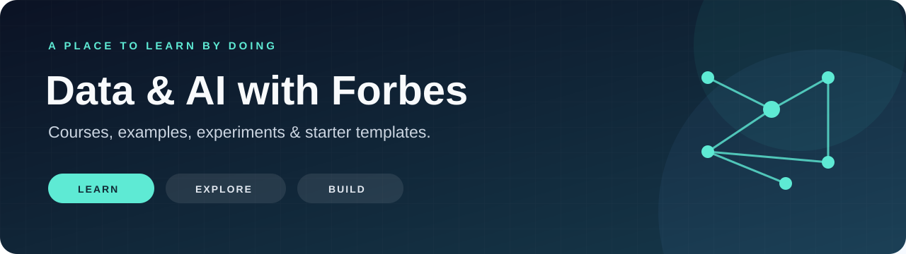

<picture>
  <source media="(prefers-color-scheme: dark)" srcset="assets/learning-banner-dark.svg">
  <source media="(prefers-color-scheme: light)" srcset="assets/learning-banner.svg">
  
</picture>

**Understand the ideas. Recognize the tools. Learn by trying.**

I'm Bernardo Forbes Costa, an AI/ML engineer and professor. This is the home base for my courses, teaching notebooks, practical examples, and experiments with data, software, and AI over the years.

**No coding experience needed to start.** Browse the explanations, examples, and resources, with code available alongside them.

## 🧭 Choose your way in

| You want to… | Your starting point |
|---|---|
| Get comfortable with the basics | [Start here: a guide for beginners](START_HERE.md) |
| Understand a topic through a small example | [Browse by concept](#-learn-by-concept) |
| Follow a guided class | [Courses & notebooks](#-courses--notebooks) |
| See how an idea became a project | [Project library](#-project-library) |
| Find books, courses, newsletters, videos, and articles | [References & resources](resources/README.md) |

## 🧠 Learn by concept

The ideas matter beyond any one library. Learn what a step achieves and how to check it; the tools are examples of ways to do that work.

| Topic | The first question | Start with |
|---|---|---|
| 🧹 **Data transformation** | How do I turn a messy table into something I can use? | [Your Data Wrestler](https://github.com/bforbesc/Your-Data-Wrestler) |
| 📊 **Data visualization** | Which chart helps me answer this question honestly? | [GDP Dashboard](https://github.com/bforbesc/gdp-dashboard) |
| 🎯 **Supervised machine learning** | Can examples with known answers help predict a new answer? | [A first classification notebook](notebooks/first-classifier.ipynb) |
| 🧩 **Unsupervised machine learning** | What groups appear when I do not provide answer labels? | [Clustering case study](https://github.com/bforbesc/clustering-web-app) |
| ✨ **Generative AI** | How does a model turn instructions and context into an answer? | [Text to tokens to tensors](notebooks/ai-fuel-from-text-to-tokens-to-tensors.ipynb), then [the GenAI course](notebooks/genai-day/) |
| 🛠️ **AI agents** | What changes when a model can choose tools and steps? | [The hotel-assistant course](notebooks/genai-day/) and [Your Data Wrestler](https://github.com/bforbesc/Your-Data-Wrestler) |
| 🌐 **Web apps & deployment** | How can someone else interact with my work in a browser? | [GDP Dashboard case study](https://github.com/bforbesc/gdp-dashboard) |
| 🎮 **Prototyping with AI tools** | How do I turn an idea into rules, feedback, and a testable result? | [Arita's Puppy Panic](https://github.com/bforbesc/arita-the-game) |

## 🎓 Courses & notebooks

Each notebook combines explanations, runnable code, and a small activity. **Colab** runs the notebook in your browser; see [the beginner guide](START_HERE.md) for your first steps.

| Resource | What you learn | Open and try | Before you begin |
|---|---|---|---|
| **AI's fuel: From Text to Tokens to Tensors** | Turn a sentence into tokens, vocabulary indices, vectors, and a tensor |  · [Read the article](https://www.linkedin.com/pulse/ais-fuel-from-text-tokens-tensors-bernardo-forbes-costa-phd-bhyhf) | Beginner; no API key |
| **Your first classifier** | Learn the difference between known labels and predictions; separate training and testing; compare with a simple baseline |  | Guided introduction; fictional data; no API key |
| **Generative AI and AI Agents** | Build an assistant for a fictional hotel: prompting, context, retrieval, tools, agents, and evaluation | [Course guide](notebooks/genai-day/) ·  | Guided class; paid API access required |
| **GenAI final challenge** | Configure the hotel concierge and test it on ten emails |  | After the course; paid API access |
| **Model fine-tuning** | Adapt a tiny open model's style and examine what fine-tuning does not change |  · [Resulting model](https://huggingface.co/bforbesc/smollm2-135m-hotel-silencio) | Optional; a T4 GPU is recommended |

## 📁 Project library

**Historical experiments, revisited as teaching case studies.** These are here to show how an idea was put together, which frameworks were used, and what we can learn from the choices. They are not presented as current production tools. Start with the explanations and samples; running the older apps is optional.

| Case study | What it teaches | Tools you will recognize | First activity |
|---|---|---|---|
| 📊 [GDP Dashboard](https://github.com/bforbesc/gdp-dashboard) | Data transformation, visualization, interactive web apps | Pandas, Streamlit | Compare two date ranges and explain why the story changes |
| 🧩 [Clustering Web App](https://github.com/bforbesc/clustering-web-app) | Unsupervised learning, preprocessing, comparing groups | Pandas, scikit-learn, Plotly, Streamlit | Group fictional shop visits with 2, 3, and 4 clusters |
| 🤼 [Your Data Wrestler](https://github.com/bforbesc/Your-Data-Wrestler) | Data cleaning, visualization, generative AI, agents, verification | Pandas, Plotly, Streamlit, Strands Agents, OpenAI | Check an assistant against a tiny order table with known issues |
| 🎮 [Arita's Puppy Panic](https://github.com/bforbesc/arita-the-game) | Prototyping, rules, feedback, building with AI tools | HTML, CSS, JavaScript | Predict a score, play a round, then change one rule |

[Read the project stories →](projects/README.md)

## 📖 References & resources

[Browse the reading and resource library →](resources/README.md)

Books such as **AI Engineering**, courses from **Hugging Face** and **DeepLearning.AI**, newsletters including **The Batch** and **AlphaSignal**, my curated playlist on the maths behind LLMs, and [my articles](resources/README.md#my-articles). Each entry describes its topic and links to the source.

## 🧰 The tools, in context

A **library** supplies reusable building blocks. A **framework** helps structure an application. Recognizing a name is useful; understanding the problem it solves is more transferable.

| Name | Why you might use it | Where it appears here |
|---|---|---|
| **[Pandas](https://pandas.pydata.org/docs/)** | Work with tables: inspect, filter, clean, reshape, and summarize | The data case studies |
| **[Plotly](https://plotly.com/python/)** | Create interactive charts | Clustering and Data Wrestler |
| **[Seaborn](https://seaborn.pydata.org/)** | Make statistical charts from tables | A related visualization library taught alongside these concepts; not used in the four case studies |
| **[scikit-learn](https://scikit-learn.org/stable/)** (`sklearn`) | Prepare data, fit machine-learning models, and evaluate them | The first classifier and clustering |
| **[TensorFlow](https://www.tensorflow.org/learn)** | Build and train neural networks | A related framework for further study; not used in the four case studies. The existing fine-tuning notebook uses PyTorch instead. |
| **[Streamlit](https://docs.streamlit.io/)** | Turn a Python script into a web app with controls, tables, and charts | The three data case studies |
| **[Strands Agents](https://strandsagents.com/docs/user-guide/sdk/quickstart/overview/)** / **[OpenAI](https://developers.openai.com/api/reference/overview)** | Connect a language model with data-inspection tools | Data Wrestler; the GenAI course explores model calls and other agent patterns |

## 🤝 Questions and contributions

[Ask a question or report a broken link](https://github.com/bforbesc/Data-AI-with-Forbes/issues) · [Contribute material](CONTRIBUTING.md) · [Follow on LinkedIn](https://www.linkedin.com/in/bernardoforbescosta/)

## 📄 Reuse and credits

This repository's code and teaching material use the [MIT License](LICENSE). Linked projects, third-party datasets, and other resources keep their own licenses and attribution requirements. Older project deployments and dependencies may need maintenance; the worksheets are available even when an app is not running.
